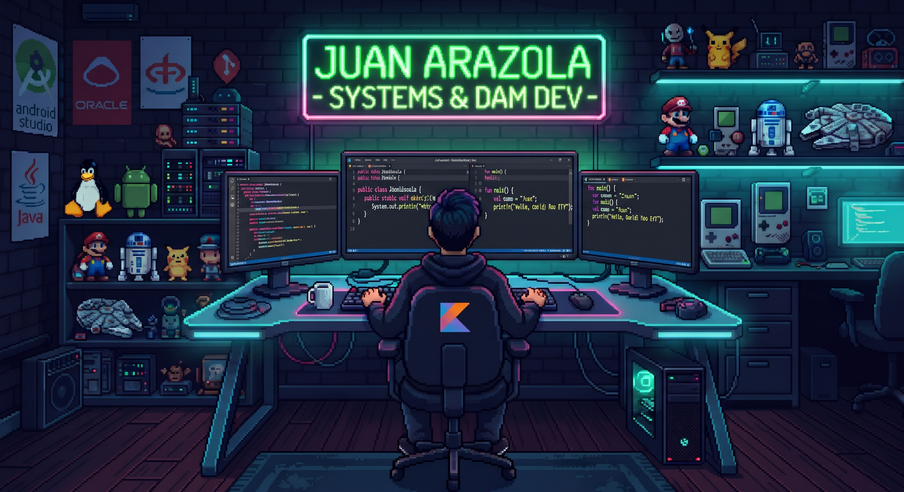

<div align="center">

  <!-- Imagen de fondo subida a tu repositorio -->
  

  <br><br>

  <!-- Tu nombre con animación moderna -->
 

</div>

---

###  About Me // Perfil Técnico

```javascript
const Juan_Arazola = {
  rol: "Estudiante de DAM (Desarrollo de Aplicaciones Multiplataforma)",
  baseTecnica: "Grado Medio en Sistemas Informáticos y Redes",
  ubicacion: "Madrid, España 🇪🇸",
  pasion: "Conectar la infraestructura, redes y bases de datos con el desarrollo de software robusto",
  stackCore: [
    "Java", 
    "Kotlin", 
    "Android Studio", 
    "Oracle SQL", 
    "PL/SQL", 
    "Maven", 
    "Git"
  ],
  enfoqueActual: "Arquitectura limpia, desarrollo multiplataforma y optimización de bases de datos",
  contacto: {
    github: "https://github.com/Juan-Arazola](https://github.com/Juan-Arazola)"
```

### 🛠️ Stack tecnológico

<div align="center">

| | |
|:--|:--|
| **Lenguajes** |    |
| **Bases de datos** |   |
| **Herramientas** |   |

</div>

---


### 🎯 En lo que estoy

- ☕ Dominio de Java y la programación orientada a objetos para crear aplicaciones robustas.

- 📱 Desarrollando y experimentando con aplicaciones multiplataforma usando Kotlin y Android Studio

- 🗄️ Profundizando en consultas avanzadas, procedimientos y paquetes con Oracle SQL / PL/SQL y MySQL

- 🤝 Abierto a conectar con profesionales, aprender cada día y colaborar en nuevos retos tecnológicos

---

### 💡 Principios con los que trabajo

> **Infraestructura sólida antes que parches** · **Robustez antes que velocidad** · **Curiosidad constante antes que comodidad**
<br/>

<div align="center">


</div>
  
